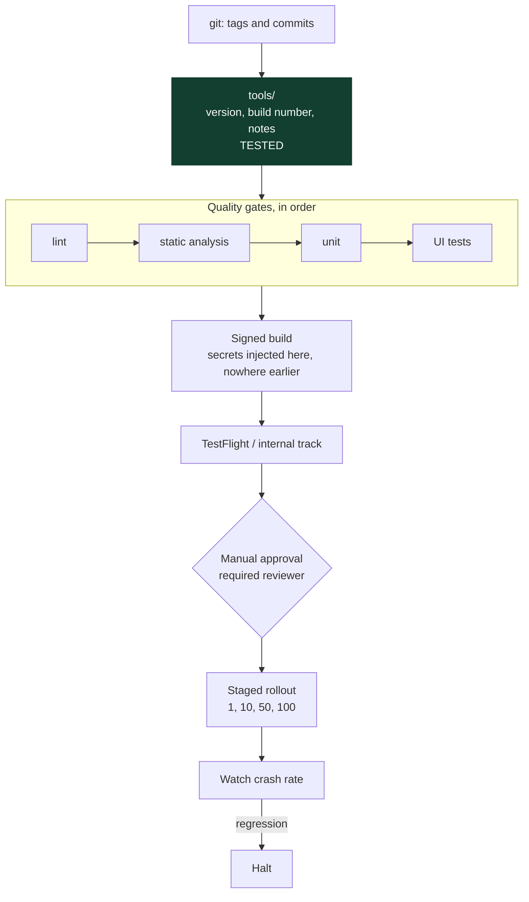

# Architecture

This repository has an unusual shape: the interesting part is a pipeline, not a program.

Only the green box has ever run.

## The three layers

**Derivation (`tools/`).** Pure TypeScript over strings. Given a tag and a list of commits,
produce the next version, the build number and the release notes, and refuse a release that
moves backwards. Tested, 44 cases.

**Orchestration (`.github/workflows/`, `fastlane/`).** Job ordering, gate enforcement,
secret injection, artifact handling. Written, never executed.

**Procedure (`docs/`).** What a person does when the automation is not enough: a hotfix at
11pm, a rollout to halt, a compromised key. Numbered steps.

The split matters because the three have different verification stories, and collapsing
them would let the untested parts borrow credibility from the tested one.

## Why signing happens after the gates, not before

A signed artifact is a thing that can be submitted. If one exists before the tests have
run, somebody will eventually submit it, usually while trying to be helpful during an
incident.

Ordering the pipeline so that no signed artifact exists until the gates pass removes that
possibility rather than relying on discipline.

## Why the version is derived rather than typed

Two mistakes are only ever caught by a machine:

- A version that does not move ahead of what shipped
- A build number that has already been submitted

A person comparing version strings at the end of a release checklist will let both through,
particularly during a hotfix, which is exactly when they are most likely and most costly.
`validateRelease` refuses them, and the hotfix-branched-from-the-wrong-tag case has its own
test.

## The constraint that shapes the runbooks

**You cannot roll back a binary a user has already installed.**

A server rollback is a task-definition change, done in three minutes. A mobile rollback is
two things: stopping further users from getting the bad version, and shipping a fix forward
through review to the ones who already have it. Only the first is fast.

That is why the pipeline gates so heavily before signing, why rollout is staged rather than
all-at-once, and why [docs/ROLLBACK.md](docs/ROLLBACK.md) spends more words on halting and
forward-fixing than on reverting.

## Configuration split

Three build configurations, differing in the three things that actually matter:

| | Debug | Staging | Release |
|---|---|---|---|
| Bundle or application id | `.debug` | `.staging` | base |
| API endpoint | localhost | staging host | production host |
| Log level | debug | info | warn |
| Minification | off | off | on |
| Signing | none | injected | injected |

Distinct identifiers so all three can be installed side by side. An engineer who has to
uninstall staging to test debug will stop testing one of them.

## What is deliberately not here

GuardianLink's product features. The apps are a safety check-in screen and a list. Anything
larger would obscure what this repository is about, and the product lives in
`guardianlink-platform`.
