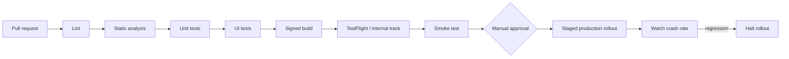

# native-release-lab

**How iOS and Android binaries get built, versioned, signed, gated, released, rolled back
and recovered.**

> Part of the [GuardianLink portfolio](../PORTFOLIO.md). A demonstration, not a real
> safety service.

The app here is deliberately small: a safety check-in screen with a list and a button. It
exists to give the pipeline something real to build. **The pipeline is the product.**

[](docs/test-results/)
[](LICENSE)

---

## What this is about

Release engineering is where a good codebase meets an unforgiving process. The failures are
specific and expensive:

- A build number reused, rejected twenty minutes into a submission
- A hotfix branched from the wrong tag, so it claims to be older than the release it fixes
- A signing certificate that expired, discovered on the day of a release
- A rollback that is impossible because the migration was not additive
- A release note that is a commit dump, rejected by review
- A secret in a build log, in a repository, or in a screenshot of a build log

Every one of those has an answer here, and the ones that can be tested are tested.

## What is verified, and what is not

Being precise about this is most of the point of the repository.

| Piece | State |
|-------|-------|
| Version, build-number and release-note derivation | **44 tests, executed, passing.** Recorded output in [docs/test-results/](docs/test-results/) |
| The release CLI | **Executed against this repository real git history.** It derived a version, generated notes from the actual commits, and refused a backwards build number with a non-zero exit |
| Fastlane lanes | Written. Never run, because running them needs a macOS machine and store credentials |
| GitHub Actions workflows | Written. Never executed, because this repository has not been pushed |
| iOS check-in app | Sources and tests written. Never compiled: no macOS, no Xcode on the build machine |
| Android check-in app | Sources and tests written. Never compiled: no Gradle distribution on the build machine |
| Any store submission | **Never attempted.** No credentials, and it needs approval |

Nothing here claims a build succeeded, a test ran on a device, or a binary reached a store.

## Version derivation

Nobody types a version number. Both the version and the build number come from git, so the
same commit always produces the same build and a submitted binary traces back to an exact
tree.

```
last tag ────────► next version    (semver bump from Conventional Commits)
commit count ────► build number    (monotonic, reproducible, not a timestamp)
commits since ───► release notes   (user-visible categories only)
```

Three decisions worth defending:

**A commit that does not follow the convention is kept, not dropped.** Type `other`.
Dropping it leaves a genuine change out of the release notes, and nobody notices until a
user asks where their fix went.

**An unrecognised set of commits gets a patch bump, not none.** Shipping a build whose
version did not move is worse than moving the patch number for a documentation change.

**Release notes contain only what a user can perceive.** A refactor is real work and
belongs in the changelog, not in the text somebody reads while deciding whether to update.
Store reviewers also reject notes that are obviously a commit dump, and there is a test
asserting the output does not look like one.

`validateRelease` refuses a release whose version or build number does not move forward.
That check exists because those two mistakes are only ever caught by a machine; a person
comparing version strings at the end of a release checklist will let them through.

```bash
cd tools
pnpm install && pnpm test
```

## Gates



No signing happens before the gates pass. A signed artifact is a thing that can be
submitted by accident, and the cheapest way to avoid that is to not produce one until it
has earned it.

Production requires a GitHub environment with a required reviewer. That is the only gate
here a person can be blamed for skipping, which is why it is the one that is enforced by
the platform rather than by a checklist.

## Signing

**No signing asset is in this repository and none ever will be.** No certificate, no
private key, no keystore, no provisioning profile, no service-account JSON. `.gitignore`
covers all of them and CI runs a secret scan over full history, because a secret committed
and later removed still leaked.

Everything is injected from a named secret at build time. The names, the rotation
procedure and what to do when one is compromised are in [docs/SECRETS.md](docs/SECRETS.md).

## Runbooks

| Document | For |
|----------|-----|
| [docs/RELEASE.md](docs/RELEASE.md) | The normal path, with the checklist |
| [docs/HOTFIX.md](docs/HOTFIX.md) | A critical bug in production, at 11pm |
| [docs/ROLLBACK.md](docs/ROLLBACK.md) | Halting a rollout, and why you cannot un-ship a binary |
| [docs/SECRETS.md](docs/SECRETS.md) | Names, rotation, compromise response |
| [docs/STORE_REVIEW.md](docs/STORE_REVIEW.md) | App Store and Play checklists, filled in for this app |

Written as numbered steps because they are read at 2am by somebody who is worried. Prose is
the wrong format for that.

## The mobile-specific reality

The thing that makes mobile release engineering different from server deployment, and the
assumption most of these runbooks are built around:

**You cannot roll back a binary that a user has already installed.** A server rollback is a
task-definition change and it is done in three minutes. A mobile rollback is halting the
rollout of a version that some people already have, and shipping a fix forward through
review.

That single fact is why the pipeline gates so heavily before signing, why production
rollout is staged rather than all-at-once, and why the rollback runbook spends more words
on halting and forward-fixing than on reverting.

## Repository layout

```text
tools/                Version derivation. TypeScript, tested
  src/versioning.ts     the rules
  src/versioning.spec.ts
  src/cli.ts            what the pipeline calls. One implementation of the rules
ios/                  Small UIKit app, Fastlane lanes, App Store Connect config structure
android/              Small Compose app, Fastlane lanes, Play publishing config structure
.github/workflows/    Build, test, release-candidate, staged production release
docs/                 Runbooks and checklists
```

## Known limitations

- **Nothing has been built or shipped.** The full list is in the table above.
- **No real signing assets exist**, so the signing steps have never executed even in a dry
  run.
- **The apps are minimal.** Enough surface to have something to test and ship, no more.
  That is deliberate; a larger app would obscure what this repository is about.
- **No crash reporting integration.** The rollout-halt criteria reference a crash rate that
  would come from a tool that is not wired in.
- **The staged rollout percentages are conventional, not derived.** 1, 10, 50, 100 because
  that is what most teams use, not because I have data.

## Suggested repository metadata

**Description:** iOS and Android release engineering: git-derived versioning, gated
pipelines, staged rollout, signing hygiene, and runbooks for hotfix and rollback.

**Topics:** `ios` `android` `fastlane` `github-actions` `release-engineering` `semver`
`conventional-commits` `code-signing` `ci-cd` `portfolio`

## Licence

[MIT](LICENSE).
